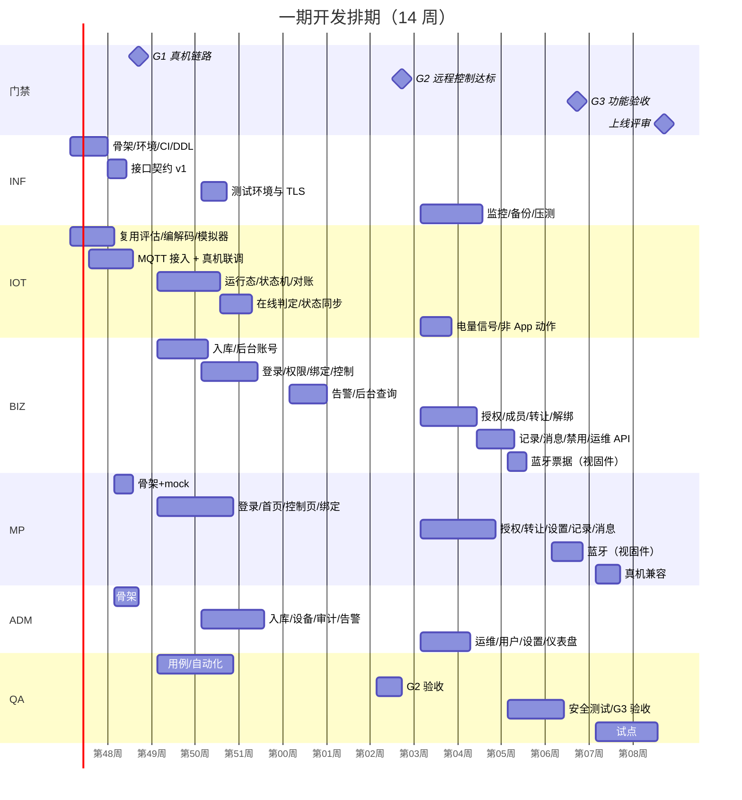
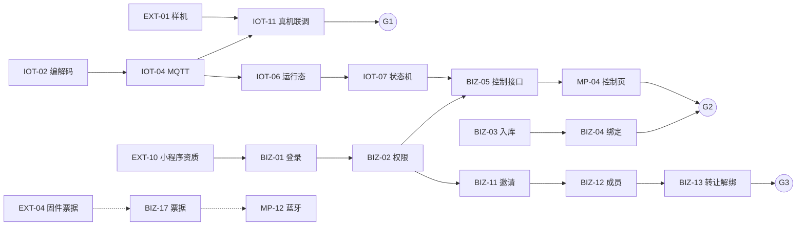

# 智能车位道闸 网络版 · 一期开发计划

Nov 25, 2026 · @Lucas · 依据 [PRD V1.1](../prd/PRD.md)

一期 14 周、4 个阶段、3 个门禁（PRD 第 11 章）。本文把 PRD 拆成 7 条开发线、约 80 个任务，给出依赖、排期和关键路径。

## 1. 前提与假设

| 项 | 假设 | 不成立时 |
| --- | --- | --- |
| 人员 | 后端 2 人（A 设备接入、B 业务），前端 2 人（A 小程序、B 管理后台），测试 1 人，产品 / 对外协调 1 人（Lucas） | 人少就合并开发线：A+B 后端由 1 人承担时，P1 延长约 3 周 |
| 估时单位 | 人天（d），只算开发与自测，不含联调缓冲；每阶段预留约 20% 缓冲 | — |
| 硬件 | 第 1 周拿到至少 3 套真机（DTU + 闸板 + 电池） | G1 只能用模拟器验证，真机风险后移 |
| 复用 | WorkBuddy 代码经 IOT-01 评估后可复用编解码、状态机、模拟器 | 设备接入线 +5d |

## 2. 仓库与工程结构

单仓多工程，便于 PRD、接口契约与代码同步演进。

```text
SmartParking/
├── docs/              PRD、开发计划、接口契约、ADR
├── server/            Java 17 + Spring Boot 3，模块化单体（Gradle 多模块）
│   ├── app/           启动与装配
│   ├── common/        错误码、统一响应、审计注解、工具
│   ├── iot/           MQTT、RS485 编解码、指令状态机、运行态、在线判定、状态同步
│   ├── device/        设备主档、入库导入、激活码、换件
│   ├── ownership/     绑定、转让、解绑、ownership_log
│   ├── member/        邀请、被授权人、有效期
│   ├── control/       控制接口、操作记录、蓝牙票据
│   ├── notify/        站内消息、告警
│   └── admin/         后台账号、RBAC、操作日志、系统参数
├── admin-web/         Vue 3 + Element Plus
├── miniapp/           原生微信小程序 + TypeScript
├── tools/dtu-sim/     DTU 模拟器（多设备、故障注入）
└── deploy/            Docker Compose、EMQX 配置、Nginx、TLS
```

模块间只通过接口和领域事件调用，不跨模块查表。`iot` 模块不感知用户与权限，只接收“对设备 X 执行动作 Y”的请求并返回结果。

**分支与协作**：`main` 始终可部署；每个任务一个 `feat/<任务号>-<简述>` 分支，经 PR 合入并跑通 CI。每个任务号对应一个 GitHub Issue，挂在对应阶段的 Milestone 上。

## 3. 开发线总览

| 线 | 负责人 | 范围 | 任务数 | 合计 |
| --- | --- | --- | --- | --- |
| INF 基础设施 | 后端 A（主）+ 测试 | 工程骨架、环境、CI、数据库、接口契约、部署、监控、压测 | 9 | 19.5d |
| IOT 设备接入 | 后端 A | MQTT、RS485、指令状态机、运行态、在线判定、状态同步、真机联调 | 13 | 29.5d |
| BIZ 业务服务 | 后端 B | 登录、权限、入库、绑定、控制接口、授权、转让、解绑、记录、消息、告警、后台 API | 18 | 37.5d |
| MP 小程序 | 前端 A | 13 个页面、分享卡片、蓝牙、真机兼容 | 13 | 28d |
| ADM 管理后台 | 前端 B | 9 个模块 | 9 | 18.5d |
| QA 测试 | 测试 | 用例、自动化、安全、试点 | 6 | 17d |
| EXT 外部依赖 | Lucas | 硬件确认、小程序资质、产线、合规文本 | 16 | — |

前端 B 的工作量较轻，P2 起支援小程序（MP-06 至 MP-11 中任选）和自动化测试。

## 4. 任务清单

优先级沿用 PRD：P0 为上线必需，P1 为一期内完成但可降级。“阶段”指计划落在哪个阶段。

### 4.1 INF 基础设施

| 编号 | 任务 | 估时 | 依赖 | 阶段 |
| --- | --- | --- | --- | --- |
| INF-01 | 工程骨架：server Gradle 多模块、admin-web、miniapp 初始化；代码规范、PR 模板、Issue 模板 | 1.5d | — | P0 |
| INF-02 | 本地开发环境：Docker Compose（MySQL 8、Redis 7、EMQX 5） | 1d | INF-01 | P0 |
| INF-03 | CI：GitHub Actions 构建、单测、lint、制品 | 1.5d | INF-01 | P0 |
| INF-04 | 数据库：Flyway 迁移，PRD 第 9 章 13 + 5 张表初版 DDL；`device_event` 按月分区 | 2d | INF-02 | P0 |
| INF-05 | **接口契约 v1**：OpenAPI 描述小程序与后台全部接口、错误码表；前端据此 mock | 3d | INF-04 | P0 |
| INF-06 | 测试 / 预发环境：云服务器、域名、HTTPS、EMQX 8883 TLS、一机一密认证源 | 3d | INF-02、EXT-11 | P1 |
| INF-07 | 生产部署方案与上线手册；数据库每日备份 + binlog，可恢复 7 天内任意时点 | 2d | INF-06 | P2 |
| INF-08 | 监控看板：在线率、指令成功率、告警数；日志检索；服务与 EMQX 告警 | 2.5d | INF-06、IOT-09 | P2 |
| INF-09 | 压测：5,000 台模拟在线、峰值 50 条/秒指令，验证接口 P95 ≤ 300 ms、控制 P95 ≤ 5 秒 | 3d | IOT-03、BIZ-05 | P2 |

### 4.2 IOT 设备接入

| 编号 | 任务 | 估时 | 依赖 | 阶段 |
| --- | --- | --- | --- | --- |
| IOT-01 | WorkBuddy 代码复用评估：编解码、状态机、对账、在线判定、导入、模拟器，输出“复用 / 改造 / 重写”清单 | 2d | — | P0 |
| IOT-02 | RS485 编解码：显式区分上下行、长度与首尾校验、码表查表（未知码不抛异常）、查询固定 `C0`；单测覆盖 PRD 8.2 全部示例 | 2d | IOT-01 | P0 |
| IOT-03 | DTU 模拟器：多设备并发；可注入到位延迟、E3、遇阻、红外、超时、断线、回显帧 | 3d | IOT-02 | P0 |
| IOT-04 | MQTT 接入：订阅 `parking/up/+`、下行 `parking/down/{imei}`、QoS 1；未登记 IMEI 拒收；EMQX 一机一密认证对接 | 3d | INF-02、IOT-02 | P0 |
| IOT-05 | EMQX 连接 / 断开事件接入（规则引擎或 Webhook），写 `last_conn_event` | 1.5d | IOT-04 | P1 |
| IOT-06 | 运行态：`device_runtime` + Redis 热数据；状态变化写 `device_event` | 2d | IOT-04、INF-04 | P1 |
| IOT-07 | **指令状态机**：幂等键、设备级串行锁、待下发 → 已下发 → 执行中 → 成功 / 失败 / 超时；执行中每 300 ms 查询；回显不算成功 | 4d | IOT-06 | P1 |
| IOT-08 | 对账任务（每 15 秒）与服务重启后未终结指令恢复 | 1.5d | IOT-07 | P1 |
| IOT-09 | 在线判定（PRD 8.5）：离线 → 休眠 → 在线优先级；三个判定时机；60 秒扫描 | 2d | IOT-05、IOT-06 | P1 |
| IOT-10 | 状态同步（PRD 8.7）：连接、绑定、控制前（缓存超过 30 秒）、定时 5 分钟（可配）下发查询 | 2d | IOT-07、IOT-09 | P1 |
| IOT-11 | **真机联调**：B100Ym-C1 + 闸板跑通查询 / 抬杆 / 落杆 / 版本；记录实测时延、粘包拆包情况 | 3d | IOT-04、EXT-01 | P0（G1） |
| IOT-12 | 电量与信号解析、电压百分比查表（硬件未提供前显示“—”） | 2d | EXT-02、EXT-09 | P2，可能阻塞 |
| IOT-13 | 非 App 动作入记录：按原因码识别遥控器 / 地感 / 延时关等，标注“发现时间” | 1.5d | IOT-10、EXT-12 | P2 |

### 4.3 BIZ 业务服务

| 编号 | 任务 | 估时 | 依赖 | 阶段 |
| --- | --- | --- | --- | --- |
| BIZ-01 | 小程序登录：code2session、手机号授权、Token、手机号加密存储、封禁拦截 | 2d | INF-04、EXT-10 | P1 |
| BIZ-02 | **统一权限判定**：设备启用 + 用户未封禁 + 主人或有效期内被授权人；所有控制类接口强制经过 | 1.5d | BIZ-01 | P1 |
| BIZ-03 | 设备入库：单台录入；批量导入（异步任务、SN 唯一、IMEI 15 位 + Luhn、文件内重复行提示、失败行导出）；激活码生成只存哈希；印刷文件（SN + 二维码 + 激活码）导出一次可见 | 4d | INF-04 | P1 |
| BIZ-04 | 扫码绑定：SN 存在 + 待激活 + 哈希匹配；5 次错误锁 30 分钟（Redis）；写 `ownership_log`；触发状态查询 | 2d | BIZ-03、BIZ-02 | P1 |
| BIZ-05 | 远程控制接口：抬杆 / 落杆、结果轮询、错误码（离线、执行中、已禁用、无权限）；写 `control_command` 操作人与角色 | 1.5d | IOT-07、BIZ-02 | P1 |
| BIZ-06 | 我的车位列表（主人 + 被授权）、设备详情、修改名称 / 车位号 | 1.5d | BIZ-02 | P1 |
| BIZ-07 | 告警：E3、遇阻、红外、连续 3 次超时、离线超 24 小时；同设备同类 30 分钟合并 | 2d | IOT-07、IOT-09 | P1 |
| BIZ-08 | 后台账号与 RBAC（超管 / 运维 / 客服）、登录失败锁定、会话超时、操作日志切面、`system_config` 参数读取 | 3d | INF-04 | P1 |
| BIZ-09 | 后台查询 API：设备列表多条件筛选与详情聚合、用户列表（脱敏）与详情、指令审计筛选与导出、仪表盘统计 | 3d | BIZ-08、IOT-06 | P1 |
| BIZ-10 | 后台运维 API：强制解绑、重置激活码、禁用 / 启用、换件（改 IMEI / MAC + `device_part_log`）、设备自检（仅查询类） | 2d | BIZ-08、BIZ-13 | P2 |
| BIZ-11 | 邀请家人：随机 ≥ 128 位 token、24 小时过期、有效期规则、待接受占名额、过期释放、接受时再次校验 | 3d | BIZ-02 | P2 |
| BIZ-12 | 成员管理：列表、修改有效期、撤销、主动退出、到期自动失效任务 | 2d | BIZ-11 | P2 |
| BIZ-13 | 转让与解绑：发起 / 取消 / 接收转让，主人解绑；同一事务内级联作废邀请与转让卡片、撤销成员、写 `ownership_log` | 3d | BIZ-12 | P2 |
| BIZ-14 | 操作记录查询：主人自成为主人起的全部记录，被授权人仅本人记录；按日期筛选 | 1.5d | BIZ-05、BIZ-13 | P2 |
| BIZ-15 | 站内消息：授权、撤销、到期、转让、解绑、故障各写入点；列表、已读 | 1.5d | BIZ-12、BIZ-13、BIZ-07 | P2 |
| BIZ-16 | 设备禁用与用户封禁的业务效果（PRD 5.8） | 1d | BIZ-02 | P2 |
| BIZ-17 | 蓝牙票据：60 秒一次性票据签发；结果上报与离线补报（幂等） | 2d | EXT-04、EXT-05 | P2，可能阻塞 |
| BIZ-18 | 微信订阅消息接入（模板审核通过后） | 1d | EXT-15、BIZ-15 | P3，可选 |

### 4.4 MP 小程序

| 编号 | 任务 | 估时 | 依赖 | 阶段 |
| --- | --- | --- | --- | --- |
| MP-01 | 工程骨架：TS、请求封装与错误码映射、登录态、mock 层、基础组件（状态徽标、电量图标、确认弹窗） | 2d | INF-01、INF-05 | P0 |
| MP-02 | 登录授权页（微信登录、手机号、协议与隐私政策） | 1d | MP-01、EXT-16 | P1 |
| MP-03 | 车位首页：列表、快捷抬杆 / 落杆、“我的 / 家人共享”标签、空态引导扫码 | 2d | MP-01 | P1 |
| MP-04 | **设备控制页**：三态主按钮、执行中动画、到位才算成功、5 秒刷新 / 执行中 1 秒轮询；离线、休眠、故障、超时、遇阻、已禁用 | 4d | MP-01 | P1 |
| MP-05 | 扫码绑定 + 绑定结果：扫普通二维码进入并带 SN、8 位激活码输入、锁定提示、等待联网 60 秒、设置名称与车位号 | 2.5d | MP-01、EXT-13 | P1 |
| MP-06 | 成员管理 + 邀请家人：名额展示、有效期选择（含自定义时间校验）、备注、分享卡片、修改与撤销 | 3d | MP-01 | P2 |
| MP-07 | 接受邀请页：四种失效态 | 1d | MP-06 | P2 |
| MP-08 | 转让发起与接收 | 1.5d | MP-01 | P2 |
| MP-09 | 设备设置：主人解绑二次确认；被授权人“退出授权” | 1d | MP-01 | P2 |
| MP-10 | 操作记录：按日期筛选、通道与触发方式展示 | 1.5d | MP-01 | P2 |
| MP-11 | 消息中心 + 我的 | 1.5d | MP-01 | P2 |
| MP-12 | 蓝牙控制：申请票据 → 搜索 → 连接 → 执行 → 结果；无网时缓存补报 | 4d | EXT-04、BIZ-17 | P2/P3，可能阻塞 |
| MP-13 | 真机兼容：iOS 13+ / Android 8+，蓝牙覆盖 ≥ 20 款机型 | 3d | MP-04、MP-12 | P3 |

### 4.5 ADM 管理后台

| 编号 | 任务 | 估时 | 依赖 | 阶段 |
| --- | --- | --- | --- | --- |
| ADM-01 | 骨架：登录、锁定提示、会话超时、按角色的菜单与按钮权限 | 3d | INF-01、INF-05 | P0–P1 |
| ADM-02 | 设备入库：单台录入、模板下载、批量导入与进度、导入记录、失败行导出、印刷文件导出 | 2.5d | ADM-01 | P1 |
| ADM-03 | 设备管理：列表筛选；详情（实时状态、主人、被授权人与有效期、指令、告警、事件流） | 3d | ADM-01 | P1 |
| ADM-04 | 指令审计：筛选、原始帧、导出 | 1.5d | ADM-01 | P1 |
| ADM-05 | 告警中心：列表、合并计数、标记处理与备注 | 1.5d | ADM-01 | P1 |
| ADM-06 | 运维操作：强制解绑（必填原因、可选重置激活码）、禁用 / 启用、换件、设备自检 | 2d | ADM-03 | P2 |
| ADM-07 | 用户管理：列表（脱敏）、详情、封禁 | 1.5d | ADM-01 | P2 |
| ADM-08 | 系统设置：账号与角色、操作日志、业务参数 | 2d | ADM-01 | P2 |
| ADM-09 | 仪表盘 | 1.5d | ADM-03 | P2 |

### 4.6 QA 测试

| 编号 | 任务 | 估时 | 依赖 | 阶段 |
| --- | --- | --- | --- | --- |
| QA-01 | 测试计划与用例：重点为指令状态机、权限矩阵、级联规则、有效期边界 | 3d | PRD | P0–P1 |
| QA-02 | 接口自动化 + 模拟器端到端（绑定 → 控制 → 授权 → 转让 → 解绑） | 4d | IOT-03、INF-05 | P1–P2 |
| QA-03 | G2 验收：内测设备远程控制成功率与 P95 时延统计 | 2d | BIZ-05、IOT-11 | P1 末 |
| QA-04 | 安全测试：越权（横向访问他人设备）、激活码爆破、token 猜测与重放、前端绕过 | 3d | BIZ-13 | P2 |
| QA-05 | G3 验收：全部 P0 页面与后台模块 | 2d | P2 全部 | P2 末 |
| QA-06 | 试点：方案、设备分发、14 天在线率、续航、信号、流量采集与报告 | 3d | G3 | P3 |

### 4.7 EXT 外部依赖与非研发事项

| 编号 | 事项 | 对应 | 截止 | 阻塞 |
| --- | --- | --- | --- | --- |
| EXT-01 | 真机样机 ≥ 3 套到位 | — | 第 1 周 | IOT-11 |
| EXT-02 | 电量获取方式与电压曲线 | PRD 12.1-1 | P0 结束 | IOT-12 |
| EXT-03 | 蓝牙 GATT 定义 | 12.1-2 | P0 结束 | MP-12 |
| EXT-04 | 固件票据校验（SN + 有效期 + HMAC）、产线写 deviceKey | 12.1-3 | P1 结束 | BIZ-17、MP-12 |
| EXT-05 | 蓝牙执行结果回传 | 12.1-4 | P1 结束 | BIZ-17 |
| EXT-06 | 模组型号与 MQTTS 证书支持 | 12.1-5 | P0 结束 | INF-06 |
| EXT-07 | 串口打包参数、心跳间隔可调范围 | 12.1-6 | P0 结束 | IOT-11、IOT-09 |
| EXT-08 | 能否远程重启 DTU | 12.1-7 | P1 结束 | — |
| EXT-09 | 信号强度能否上报 | 12.1-8 | P0 结束 | IOT-12 |
| EXT-10 | 小程序主体认证、类目、手机号能力 | 12.2 | **第 1 周启动** | BIZ-01 |
| EXT-11 | 域名备案与 HTTPS 证书 | 12.2 | **第 1 周启动** | INF-06 |
| EXT-12 | 闸板是否主动上报非平台动作 | 12.1-10 | P0 结束 | IOT-13、IOT-10 参数 |
| EXT-13 | 机身二维码方案：“扫普通链接二维码打开小程序”规则与域名校验文件；印刷文件版式 | — | P1 第 2 周 | MP-05 |
| EXT-14 | 产线流程：DTU 参数与一机一密预置、印刷文件交付方式 | — | P1 结束 | 试点 |
| EXT-15 | 订阅消息模板申请 | 6.2 | P2 | BIZ-18 |
| EXT-16 | 用户协议、隐私政策文本（手机号、蓝牙、位置） | 10 | P1 第 2 周 | MP-02、上线 |

12.1 第 11 项（DTU 心跳是否上行）与 EXT-07 合并跟踪。

## 5. 排期



起始日按 2026-11-30（周一）计算，假设 12 月底到元旦有一周低产出，已在 P1 内消化。阶段边界：P0 第 1–2 周（至 12-11），P1 第 3–8 周（至 01-22），P2 第 9–12 周（至 02-19），P3 第 13–14 周（至 03-05）。

### 5.1 各阶段交付与门禁检查项

| 阶段 | 交付 | 门禁检查项 |
| --- | --- | --- |
| P0 | 工程骨架、CI、本地环境、DDL、接口契约 v1、编解码与模拟器、MQTT 接入、真机查询 / 抬杆 / 落杆 | **G1**：真机连续 100 次抬落杆，回执判定正确；EXT 中 P0 截止事项均有书面结论；小程序与域名资质已提交 |
| P1 | 入库、绑定、远程控制全链路、在线判定、状态同步、告警、后台设备 / 审计 / 告警、小程序登录 / 首页 / 控制页 / 绑定，测试环境上线 | **G2**：≥ 10 台内测设备连续 7 天，远程控制成功率 ≥ 99%、点击到到位 P95 ≤ 5 秒；状态机异常注入用例全部通过 |
| P2 | 授权、成员、转让、解绑、记录、消息、禁用封禁、后台全部模块、监控、压测；蓝牙视固件进度 | **G3**：PRD 6.1 全部 P0 页面与第 7 章 P0 模块验收通过；安全测试无高危；压测达标 |
| P3 | 试点、真机兼容、问题修复、上线手册 | **上线评审**：试点 14 天在线率 ≥ 98%，开箱到绑定中位耗时 ≤ 3 分钟，控制记录可追溯率 100% |

## 6. 关键路径与依赖



- **关键路径**：样机 → 真机联调 → 运行态 → 指令状态机 → 控制接口 → 控制页 → G2。后端 A 是瓶颈，P1 不要再给他排其他线的任务。
- **资质并行**：EXT-10 / EXT-11 审核周期不可控，第 1 周必须提交；审核未完成前，小程序用体验版 + 测试号联调，不阻塞开发。
- **前后端解耦**：INF-05 接口契约是两条前端线的起点，第 2 周末必须冻结 v1；之后改动走 PR 并通知前端。
- **蓝牙是虚线**：不阻塞任何门禁。EXT-04 若在 P1 结束前未落地，蓝牙整体移出一期，MP-12 与 BIZ-17 取消，前端 A 的时间转给 MP-13 和问题修复。

## 7. 风险与应对

| 风险 | 信号 | 应对 |
| --- | --- | --- |
| 真机到位晚 | 第 1 周末无样机 | G1 改为“模拟器全链路 + 真机补测”，真机联调延后但必须在 P1 第 2 周前完成 |
| 状态机在真实 4G 下不稳定（粘包、回显、乱序） | IOT-11 出现解析失败或误判 | IOT-03 模拟器补充对应注入；必要时调整 DTU 打包参数（EXT-07） |
| 后端 A 过载 | P1 中期 IOT 线延期 | INF-06、INF-08 移交测试或后端 B；IOT-12、IOT-13 移到 P3 |
| 小程序资质卡审 | 第 4 周仍未通过 | 先用测试号完成开发与内测；G2 用体验版验收 |
| 定时查询的流量与功耗超预期 | 试点数据 | 调大查询间隔（后台参数），依 EXT-12 结论关闭定时查询 |

## 8. 下一步

1. 确认人员与开发线负责人，按第 1 章调整估时。
2. 在 GitHub 建 4 个 Milestone（P0–P3）和本表任务对应的 Issue，按开发线打标签（`line:iot` 等）。
3. 第 1 周启动 EXT-01、EXT-10、EXT-11，并把 PRD 12.1 的硬件问题清单发给厂家。
4. 开始 INF-01 工程骨架。
